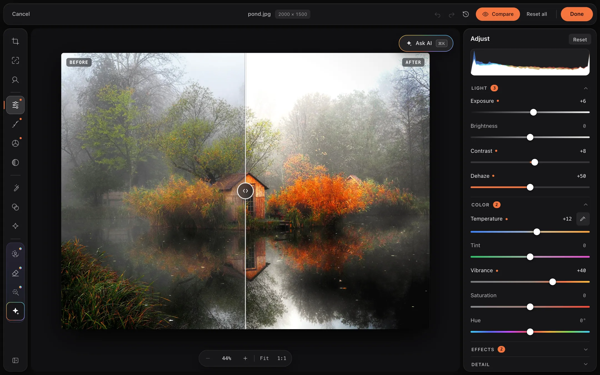

<p align="center">
  <br />
  <picture>
    <source media="(prefers-color-scheme: dark)" srcset=".github/retouch-logo-dark.svg" />
    <source media="(prefers-color-scheme: light)" srcset=".github/retouch-logo-light.svg" />
    
  </picture>
  <br />
</p>

<h3 align="center">A drop-in image and video editor that feels like part of your app.</h3>

<p align="center">
  Drop files, browse, click to edit: three states, one component. Canvas-native,
  framework-agnostic, with video and on-device ML.
</p>

<p align="center">
  <a href="https://retouch.64tensor.com">Live demo</a> &nbsp;·&nbsp;
  <a href="packages/retouch#readme">Documentation</a> &nbsp;·&nbsp;
  <a href="packages/retouch/CHANGELOG.md">Changelog</a> &nbsp;·&nbsp;
  <a href="CONTRIBUTING.md">Contributing</a>
</p>

<p align="center">
  
</p>

## Packages

| Package                                 | What it is                                                                                                                                                                |
| --------------------------------------- | ------------------------------------------------------------------------------------------------------------------------------------------------------------------------- |
| [`@64tensor/retouch`](packages/retouch) | The editor: drop zone, gallery and editor in one component. Crop, adjust, filters, curves, masks, trim, metadata, AI edits, and your own tools.                           |
| [`@64tensor/retouch-ml`](packages/ml)   | Optional on-device ML tools: cutout, 4× upscale, erase, click-to-select, depth bokeh, denoise, detection, tracking and OCR, through ONNX Runtime Web. No server, no keys. |

```bash
npm install @64tensor/retouch
```

```ts
import { Retouch } from "@64tensor/retouch";

const retouch = new Retouch({
  target: "#editor",
  onDone: (blobs) => upload(blobs), // edited files, one Blob per entry
});
```

Everything else (options, the API, theming, writing your own tools) is in the
[package's README](packages/retouch#readme) and its [docs](packages/retouch/docs).

## License

The code is [MIT](LICENSE). The models the ML tools download aren't covered by that license; each
keeps its own terms, listed in [THIRD_PARTY_NOTICES.md](packages/ml/THIRD_PARTY_NOTICES.md).

Made by [64Tensor](https://64tensor.com).
